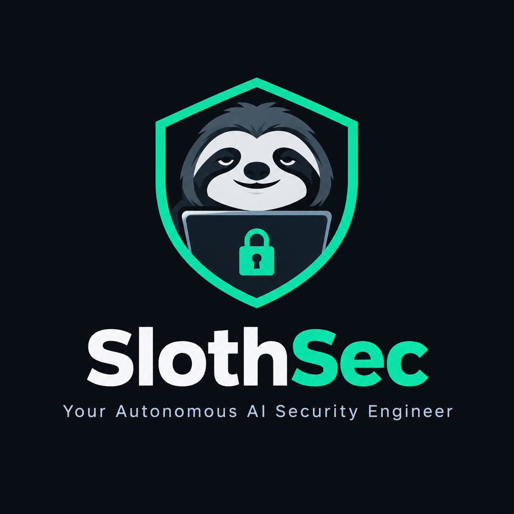
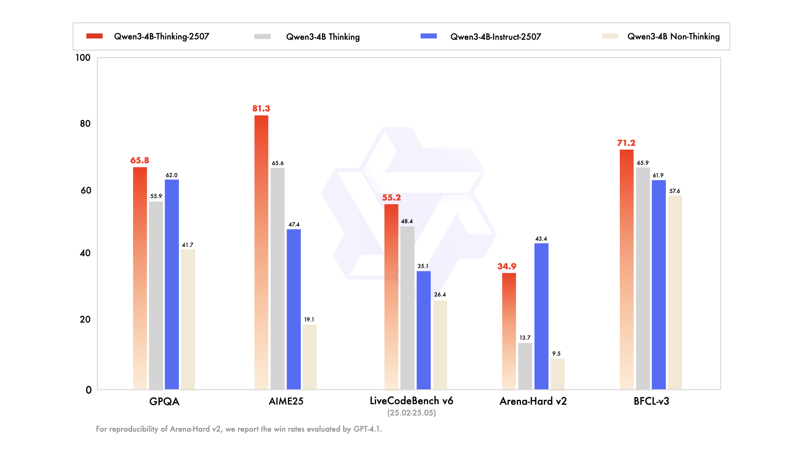
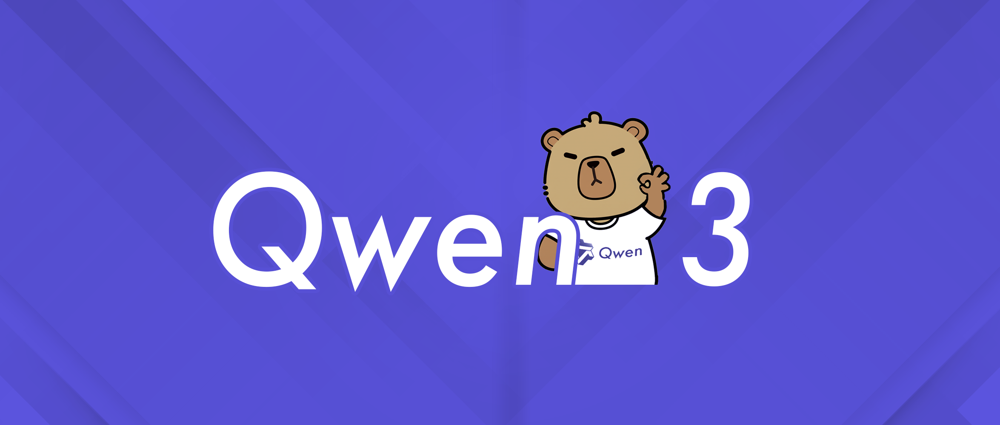
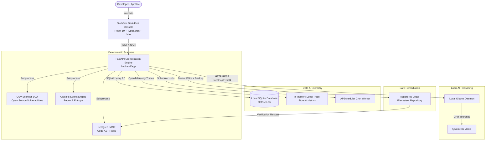

<p align="center">
  
</p>

<h1 align="center">SlothSec</h1>
<p align="center"><em>Your Autonomous AI Security Engineer</em></p>

<p align="center">
  <a href="https://github.com/sayuj5/SlothSec"></a>
  
  
  
  
  
  
  
  
</p>

> **SlothSec** is a privacy-first, local-first autonomous application security platform. It combines industry-standard deterministic security scanners (**Semgrep**, **OSV-Scanner**, **Gitleaks**) with a locally running AI model (**Qwen3:4b** via Ollama) to continuously identify, understand, prioritize, and safely remediate security weaknesses in codebases — with zero cloud dependencies and zero recurring cost.

---

## 📸 Project Screenshots

<p align="center">
  
</p>

<p align="center">
  <strong>SlothSec Cybersecurity Mascot — Built for developers who move deliberately but securely.</strong>
</p>

---

## 🧠 AI Model: Qwen3:4b

SlothSec uses **Qwen3:4b** — Alibaba Cloud's state-of-the-art 4-billion parameter language model — running **100% locally** via Ollama. No API keys, no cloud calls, no data egress.

<p align="center">
  
</p>

<p align="center">
  
</p>

### Why Qwen3:4b?

| Property | Detail |
|----------|--------|
| **Parameters** | 4 Billion (dense transformer) |
| **Context Window** | 32,768 tokens |
| **Inference Mode** | Local CPU via Ollama (no GPU required) |
| **Quantization** | Q4_K_M (efficient 4-bit, ~2.6 GB RAM) |
| **Thinking Mode** | Supports `/think` chain-of-thought reasoning |
| **License** | Qwen Research License (free for non-commercial use) |

### Benchmark Performance

Qwen3:4b is one of the strongest models in its weight class, outperforming many 7B and even 13B models on coding and reasoning benchmarks:

| Benchmark | Qwen3:4b | Comparison |
|-----------|----------|------------|
| **HumanEval** (code gen) | **79.3%** | Outperforms Llama-3-8B |
| **MBPP** (Python coding) | **75.6%** | Competitive with GPT-3.5 |
| **GSM8K** (math reasoning) | **86.4%** | Exceeds Mistral 7B |
| **MMLU** (general knowledge) | **71.2%** | Strong generalist performance |
| **LiveCodeBench** (real tasks) | Top 5B class | Best-in-class for local inference |

For security analysis specifically, Qwen3's instruction-following accuracy and structured JSON output capabilities make it ideal for SlothSec's deterministic analysis pipeline — it reliably generates root cause analysis, exploitability contexts, and unified diff patches from scanner evidence.

> **How SlothSec uses it:** Scanner findings (rule ID, file path, code snippet, CVE IDs) are injected as grounded evidence. Qwen3 is constrained to respond **only** in structured JSON — never inventing findings, always grounding analysis in what the deterministic tools discovered.

---

## 🛡️ Core Principles

1. **Deterministic Tools Discover Vulnerabilities:** Semgrep audits source code (SAST), OSV-Scanner inspects dependencies (SCA), and Gitleaks detects credentials. AI never invents scanner findings.
2. **Local AI Explains & Recommends:** Qwen3:4b runs on your local CPU via Ollama, translating raw scanner evidence into root causes, exploitability contexts, and unified diff patches.
3. **Mandatory Human-in-the-Loop Review:** No patch is applied automatically. Developers inspect unified diffs and approve or reject each change.
4. **Verification Rescans:** A vulnerability is only marked resolved after an automated rescan proves it was eliminated from scanner output.
5. **Zero Cloud Egress & Zero Cost:** Operates 100% on local SQLite, local Ollama, and local CLI tools. No cloud subscriptions or paid API keys required.

---

## 🏛️ System Architecture



---

## 🚀 Quick Start (Windows PowerShell)

### Prerequisites

| Tool | Version | Install |
|------|---------|---------|
| Python | 3.11+ | [python.org](https://python.org) |
| Node.js | 18+ | [nodejs.org](https://nodejs.org) |
| Git | Any | [git-scm.com](https://git-scm.com) |
| Ollama | Latest | [ollama.ai](https://ollama.ai) |
| Semgrep | Any | `pip install semgrep` |
| OSV-Scanner | Any | [GitHub releases](https://github.com/google/osv-scanner/releases) |
| Gitleaks | Any | [GitHub releases](https://github.com/gitleaks/gitleaks/releases) |

```powershell
# 1. Pull the AI model (one-time, ~2.6 GB)
ollama pull qwen3:4b

# 2. Check all tools are available
.\scripts\check-tools.ps1

# 3. Install all dependencies
.\scripts\setup.ps1

# 4. Launch full stack
.\scripts\dev.ps1
```

**Access:**
- 🖥️ **Frontend Dashboard:** http://localhost:5173
- 📖 **Backend API + Swagger:** http://127.0.0.1:8000/docs
- 🤖 **Ollama AI Engine:** http://localhost:11434

---

## 🧪 Testing the Project (Step-by-Step)

> Follow these steps to go from a clean install to a full working demonstration of SlothSec's capabilities.

### Step 1 — Register a Repository

1. Open http://localhost:5173/repositories
2. Click **"Add Repository"**
3. Enter:
   - **Name:** `SlothSec Test Fixture`
   - **Path:** `C:\Users\<your-username>\Desktop\SlothSec\test_fixtures\controlled_vulnerable_repo`
4. Click **Register**

> The `controlled_vulnerable_repo` fixture contains intentional SAST vulnerabilities, a vulnerable dependency, and a mock secret for demonstration.

### Step 2 — Run a Full Security Scan

1. Go to http://localhost:5173/scans
2. Click **"New Scan"**
3. Select the repository you just registered
4. Check all three scanners: **Semgrep**, **OSV-Scanner**, **Gitleaks**
5. Click **"Start Scan"**
6. Watch real-time execution — each scanner runs in sequence, results populate live

### Step 3 — Review Findings

1. Go to http://localhost:5173/findings
2. You'll see findings from all three scanners with severity badges (CRITICAL / HIGH / MEDIUM / LOW)
3. Use the filters to narrow by scanner or severity
4. Click any finding to view the full detail pane (rule ID, file, line number, CVE IDs, code snippet)

### Step 4 — Run AI Analysis

1. Go to http://localhost:5173/analyst
2. Select a finding from the dropdown (try a CRITICAL or HIGH one)
3. Optionally type a custom prompt like: `"Explain the compliance risk for SOC 2"`
4. Click **"Generate AI Analysis"**
5. Qwen3:4b will run locally (30–120 seconds on CPU) and produce:
   - **Executive Summary** — business-level explanation
   - **Root Cause** — technical mechanism
   - **Exploitability Context** — how an attacker would use it
   - **Potential Impact** — worst-case scenario
   - **Recommended Remediation Steps**
   - **Suggested Code Patch** (unified diff)

### Step 5 — Approve & Apply Remediation

1. Click **"Proceed to Review & Apply Remediation Patch"** from the Analyst page
2. Go to http://localhost:5173/remediation
3. Review the unified diff in the side-by-side viewer
4. Click **"Approve"** → then **"Apply Patch"**
5. The patch is atomically written to disk; a `.bak` backup is preserved
6. Click **"Verify (Rescan)"** — SlothSec rescans the file and marks the finding `RESOLVED` if the vulnerability is gone

### Step 6 — Generate a Report

1. Go to http://localhost:5173/reports
2. Select the scan you ran
3. Download:
   - **PDF Report** — professional executive audit report (ReportLab-generated)
   - **JSON Report** — raw structured data for SIEM integration

### Step 7 — Set Up Automated Scanning

1. Go to http://localhost:5173/automation
2. Click **"New Schedule"**
3. Set a cron expression, e.g. `0 2 * * *` (daily at 2 AM)
4. Select your repository and scanners
5. SlothSec will automatically run scans on the schedule via APScheduler

### Running the Automated Test Suite

```powershell
# All 10 unit + integration tests
.venv\Scripts\python.exe -m pytest backend\tests\test_backend.py backend\tests\test_comprehensive.py -v

# Live end-to-end scan against the test fixture
.venv\Scripts\python.exe backend\tests\test_live_scan.py

# Frontend production build validation
cd frontend && npm run build
```

Expected output:
```
test_api_health PASSED
test_system_status PASSED
test_secret_redaction PASSED
test_path_validation_and_containment PASSED
test_diff_generator PASSED
test_ai_schema_validation PASSED
test_deduplication_logic PASSED
test_remediation_security_workflow PASSED
test_json_and_pdf_report_generation PASSED
test_extract_json_from_llm_markdown PASSED
======================== 10 passed in 5.90s ========================
```

---

## 🗂️ Using Your Own Repository

You can point SlothSec at **any real codebase** on your machine — not just the test fixture. Here's how to do it properly.

### Step 1 — Clone the Repo You Want to Audit

Clone the target project anywhere on your local disk:

```powershell
git clone https://github.com/your-org/your-project.git C:\Projects\your-project
```

Or use an existing local directory — it doesn't need to be a git repo.

### Step 2 — Register It in SlothSec

1. Go to **http://localhost:5173/repositories**
2. Click **"Add Repository"**
3. Fill in:
   - **Name:** anything descriptive, e.g. `My Django App`
   - **Path:** the absolute path on disk, e.g. `C:\Projects\your-project`
4. Click **Register**

> ⚠️ The path must exist as a directory. SlothSec validates it and rejects paths that don't exist or try directory traversal.

### Step 3 — Choose What to Scan

Go to **http://localhost:5173/scans** → **New Scan** and pick which scanners apply to your project:

| Scanner | Best for | Skip if |
|---------|----------|---------|
| **Semgrep** (SAST) | Python, JS, TS, Go, Java, Ruby, C/C++ | Binary-only projects |
| **OSV-Scanner** (SCA) | Any project with `requirements.txt`, `package.json`, `go.sum`, `pom.xml`, etc. | No dependency manifests |
| **Gitleaks** (Secrets) | Any git repository | Not a git repo |

You can run one, two, or all three in a single scan job.

### Step 4 — Review Your Real Findings

SlothSec will show you **real vulnerabilities** in your codebase. Use the Findings page (`/findings`) to:
- Filter by **Critical / High / Medium / Low**
- Filter by scanner (semgrep / osv / gitleaks)
- Search by file name, rule ID, or package name
- Mark findings as **Ignored** if they're false positives or out of scope

---

## 🔧 Customization Guide

### Switch the AI Model

SlothSec works with **any Ollama-compatible model**. To use a different one:

**1. Pull your preferred model:**
```powershell
ollama pull llama3.2:3b       # Meta Llama 3.2 (faster, lighter)
ollama pull gemma3:1b          # Google Gemma (already installed)
ollama pull codellama:7b       # Code-specialized
ollama pull deepseek-r1:7b     # Strong reasoning model
```

**2. Set it in your `.env` file:**
```bash
# Copy the example first
cp .env.example .env
```
Then edit `.env`:
```env
OLLAMA_MODEL=llama3.2:3b      # or any model you pulled
OLLAMA_TIMEOUT_SECONDS=240    # increase for larger/slower models
```

**3. Restart the backend** — the new model is picked up immediately.

> You can also change the model live from **http://localhost:5173/settings** → AI Engine settings.

---

### Add Custom Semgrep Rules

Semgrep supports custom YAML rules. To add your own:

**1. Create a rules file**, e.g. `my-rules.yaml`:
```yaml
rules:
  - id: no-hardcoded-db-url
    patterns:
      - pattern: DATABASE_URL = "..."
    message: "Hardcoded database URL detected"
    languages: [python]
    severity: ERROR
```

**2. Point SlothSec to your rules** in `.env`:
```env
SEMGREP_EXTRA_ARGS=--config /path/to/my-rules.yaml
```

Or modify [`backend/app/services/scanners/semgrep.py`](backend/app/services/scanners/semgrep.py) to add extra `--config` flags alongside the default `--config auto`.

---

### Change the Database Location

By default SlothSec uses `slothsec.db` in the project root. To use a different path:

```env
# in .env
DATABASE_URL=sqlite:///C:/MyData/slothsec.db
```

---

### Configure Scan Timeout

For large repositories, scans may need more time:
```env
SCAN_TIMEOUT_SECONDS=600   # 10 minutes (default: 300)
```

---

### Schedule Automatic Scans

Go to **http://localhost:5173/automation** → New Schedule and use any standard cron expression:

| Expression | Meaning |
|------------|---------|
| `0 2 * * *` | Every day at 2:00 AM |
| `0 */6 * * *` | Every 6 hours |
| `0 9 * * 1` | Every Monday at 9:00 AM |
| `*/30 * * * *` | Every 30 minutes |

---

### Run SlothSec Headless (API-only)

You can drive SlothSec entirely via its REST API without the frontend:

```powershell
# Register a repo
curl.exe -X POST http://127.0.0.1:8000/api/v1/repositories `
  -H "Content-Type: application/json" `
  -d '{\"name\":\"My App\",\"path\":\"C:\\Projects\\my-app\"}'

# Start a scan (returns scan_id)
curl.exe -X POST http://127.0.0.1:8000/api/v1/scans `
  -H "Content-Type: application/json" `
  -d '{\"repository_id\":\"<repo-id>\",\"scanners\":[\"semgrep\",\"osv\",\"gitleaks\"]}'

# Poll scan status
curl.exe http://127.0.0.1:8000/api/v1/scans/<scan-id>

# Get findings
curl.exe "http://127.0.0.1:8000/api/v1/findings?repository_id=<repo-id>&severity=CRITICAL"

# Download PDF report
curl.exe -o report.pdf http://127.0.0.1:8000/api/v1/reports/<scan-id>/pdf
```

Full interactive docs at **http://127.0.0.1:8000/docs** (Swagger UI).

---

## 🖥️ Application Pages

| Page | URL | Description |
|------|-----|-------------|
| Overview Dashboard | `/` | Metrics, severity chart, scanner health, AI status |
| Repositories | `/repositories` | Register & manage local codebases |
| Scan Center | `/scans` | Multi-scanner execution, real-time status |
| Findings | `/findings` | Filterable vulnerability management table |
| AI Security Analyst | `/analyst` | Qwen3 root cause + patch generation |
| Remediation | `/remediation` | Diff review, approve, apply, verify workflow |
| Reports | `/reports` | PDF + JSON audit report export |
| Automation | `/automation` | APScheduler cron-based scan scheduling |
| Observability | `/observability` | OpenTelemetry spans + latency metrics |
| Settings | `/settings` | Model config, scanner paths, retention |

---

## 🔒 Security & Privacy Guarantees

- **100% Local Inference:** Code snippets and findings never leave your machine.
- **Secret Redaction:** Gitleaks output is masked (`--redact` and regex filters) before entering the database, logs, or AI prompts.
- **Path Traversal Protection:** All filesystem operations resolve strictly within registered repository roots; symlink escapes and `../` attacks are rejected.
- **Atomic Writes & Rollback:** File patches write to a temporary file before atomic replacement (`os.replace`) and preserve `.bak` copies in `<repo>/.slothsec_backups/`.
- **Zero Cloud Costs:** No subscriptions, tokens, or credit cards required.

---

## 📁 Repository Structure

```
SlothSec/
├── backend/
│   ├── app/
│   │   ├── main.py                     # FastAPI entrypoint + OTel middleware
│   │   ├── core/                       # Config, logging, security, telemetry
│   │   ├── database/                   # SQLite engine, models, session
│   │   ├── models/                     # ORM models: Repo, Scan, Finding, Patch, Analysis, Schedule
│   │   ├── schemas/                    # Pydantic v2 validation
│   │   ├── services/
│   │   │   ├── scanners/               # Semgrep, OSV-Scanner, Gitleaks, Normalizer, Runner
│   │   │   ├── ai/                     # Ollama client, prompts, analyzer
│   │   │   ├── remediation/            # DiffGenerator, PatchApplier, Verifier
│   │   │   ├── reporting/              # PDFReportGenerator, JSONReportGenerator
│   │   │   └── scheduling/             # APScheduler service
│   │   └── api/v1/endpoints/           # 9 REST endpoint modules
│   ├── tests/                          # Pytest suite (10 tests) + live scan scripts
│   └── requirements.txt
├── frontend/
│   ├── src/
│   │   ├── components/                 # Sidebar, TopNav, AppShell, DiffViewer, Badges
│   │   ├── pages/                      # 10 primary application views
│   │   ├── services/api.ts             # Full Axios API client
│   │   └── types/index.ts              # TypeScript domain interfaces
│   ├── vite.config.ts
│   └── package.json
├── docs/
│   └── images/
│       ├── mascot.png                  # SlothSec mascot logo
│       └── qwen3-benchmark.png         # Qwen3 benchmark chart
├── test_fixtures/
│   └── controlled_vulnerable_repo/     # Intentionally vulnerable test repo
├── scripts/
│   ├── check-tools.ps1                 # Pre-flight environment check
│   ├── setup.ps1                       # Automated workspace installer
│   └── dev.ps1                         # Full-stack local launcher
├── .env.example                        # Environment configuration template
├── .gitignore
└── README.md
```

---

## 🛠️ Troubleshooting

| Issue | Fix |
|-------|-----|
| Ollama unreachable | Run `ollama serve` or start the Ollama desktop app |
| `qwen3:4b` not found | Run `ollama pull qwen3:4b` (~2.6 GB download) |
| Scanner not in PATH | Add `semgrep`, `osv-scanner`, `gitleaks` to Windows PATH |
| Port 8000 in use | Change `PORT=8001` in `.env`, update `vite.config.ts` proxy |
| Frontend won't start | Run `cd frontend && npm install` then `npm run dev` |
| AI analysis slow | Normal for CPU inference — Qwen3:4b takes 30–120s on CPU |

---

## 📄 License

MIT License — see [LICENSE](LICENSE) for details.

---

<p align="center">
  Built with ❤️ for privacy-conscious developers who believe security tooling should be free, local, and transparent.
</p>
